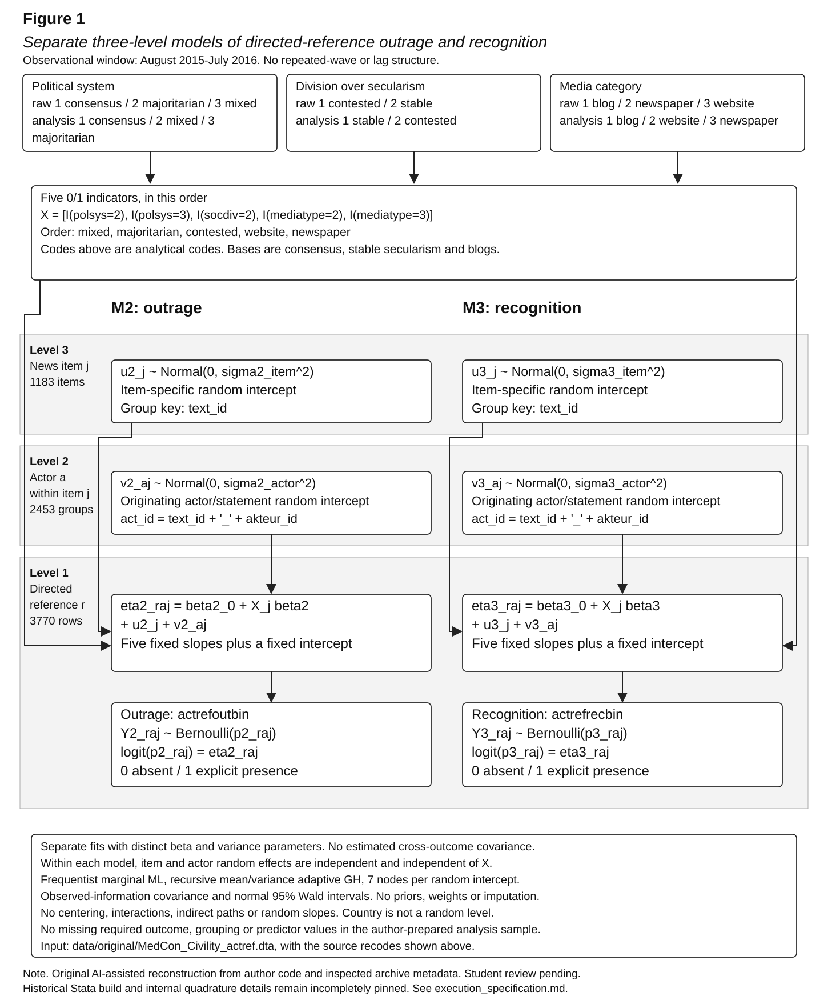
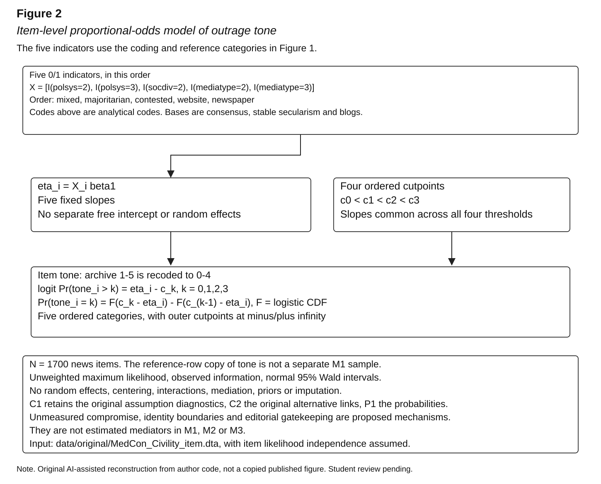

# Model diagrams and equation-to-code map

Updated on 20 October 2026. These are original AI-assisted reconstructions from
the author syntax and inspected input metadata. They document the models that
were executed, with student review still pending. They are not presented as a
student's pre-AI sketch or as pre-estimation approval.

**Figure 1**

*Separate three-level models of directed-reference outrage and recognition*



*Note.* Each model has its own five fixed slopes, intercept, item variance and
actor/statement variance. M2 and M3 are fitted separately. No shared coefficients
or cross-outcome covariance is estimated. Within a model, the Gaussian item and
actor random intercepts are independent of one another and of the covariates.
The reference level is nested within originating actor/statement groups within
items. Countries and media categories are fixed predictors, not random levels.

Open the [editable Mermaid source](model_diagram.mmd),
[vector figure](figures/model_diagram.svg),
[PNG copy](figures/model_diagram.png) or
[node-to-equation/code/matrix map](model_diagram_map.csv).

The five indicator definitions and their raw-to-analysis recodes are shown in
the figure. All covariates retain their original categories. No centering,
interaction, indirect effect, random slope, weight, prior or imputation was used.
No additional auxiliary metadata has been introduced as a control variable.
The figure does not imply that compromise, identity boundaries or gatekeeping
were directly measured mediators.

## Exact advanced-model specification

For model t=2 (outrage) or t=3 (recognition), fitted separately,

`Y_t,raj | u_t,j,v_t,aj ~ Bernoulli(p_t,raj)`

`logit(p_t,raj) = beta_t,0 + X_j beta_t + u_t,j + v_t,aj`

`u_t,j ~ Normal(0,sigma_t,item^2)` and
`v_t,aj ~ Normal(0,sigma_t,actor^2)`.

The actor/statement key is `act_id=text_id+'_'+akteur_id`. It identifies a unit
within an item and does not track a person across the corpus. The observation
counts are 3770 references, 2453 actor/statement groups and 1183 news items.
The model is frequentist marginal maximum likelihood, not Bayesian estimation.
Both random intercepts use seven-node adaptive Gauss-Hermite integration in the
primary calculation. The original author command explicitly specifies seven
points. The Python implementation uses recursive mean/variance adaptation.
Historical executable builds and internal finite-node details were not fully
recovered and are not invented here. These are implementation boundaries, not
additional paths in the substantive model.

The executing syntax is

```stata
melogit actrefoutbin i.polsys i.socdiv i.mediatype || text_id: || act_id:, intpoints(7)
melogit actrefrecbin i.polsys i.socdiv i.mediatype || text_id: || act_id:, intpoints(7)
```

This is source syntax for reference. The executed implementation is
`analysis/run_binary_models.py` calling `analysis/nested_logit.py`. Coding and
grouping are implemented in `analysis/prepare_replication.py`. Conditional odds
ratios from these models differ from the prior-marginal probabilities and
discrete contrasts in `analysis/binary_predictions.py`.

**Figure 2**

*Item-level proportional-odds model of outrage tone*



*Note.* This companion model uses the 1700 original item rows. The copied tone
field in the reference archive is not a different M1 analysis sample. Four
ordered cutpoints identify the ordinal likelihood without a separate free
intercept. There are five fixed slopes and no random effects.

Open the [editable M1 Mermaid source](model_diagram_m1.mmd),
[M1 vector figure](figures/model_diagram_m1.svg) or
[M1 PNG copy](figures/model_diagram_m1.png).

The upper-tail equation is
`logit Pr(tone_i>k)=X_i beta1-c_k` for k=0,1,2,3, with ordered cutpoints.
Its implied category probabilities are the differences of adjacent cumulative
logistic probabilities. This sign convention agrees with the author's positive
slopes meaning greater outrage. The faithful sample uses archive tone minus one
and the same five dummy predictors as the binary models. The execution is in
`analysis/ordinal_reproduction.py`.

## Follow a diagram element to its evidence

The [mapping CSV](model_diagram_map.csv) gives each node's measurement or
distribution, equation, model ID, matrix row IDs, exact executing functions and
source locator. Every source path is an existing file. The column named
`planned_script_path` is retained for the first skill's original contract, but
the rows explicitly identify these paths as executed implementations.

POL, SEC and MED explain coding. X contains all five derived fixed-effect
indicators. M2U/M3U and M2V/M3V represent separate random intercepts, not measured
latent psychological constructs. M2ETA/M3ETA are linear predictors and M2Y/M3Y
are the actual binary outcomes. M1ETA/M1C/M1Y give the fixed predictor,
identification thresholds and ordinal outcome. CONFIG nodes state model-wide
restrictions. Node labels and SVG placements come from a single saved registry.
Mermaid and SVG are two exports of that registry, not separate scientific models.

For each original directional contrast, follow the corresponding
[matrix row](hypothesis_matrix.csv). Mixed-system coefficients remain additional
comparisons. The [dictionary guide](variable_dictionary.md) explains the source
names, indicators, categories and preserved coding-rule exceptions.

## Report and review use

The model diagram requirement is documented here with figure numbers, titles,
notes, editable source and equation/code/matrix links. A suitable report
cross-reference is, "Figure 1 in the repository documents the two separately
estimated nested binary models, including their category coding and random
intercepts." The individual final report was not edited during this task.
Its final cross-reference and the student's review can be added during the next
report revision. No review or authorship declaration is supplied on the
student's behalf.
